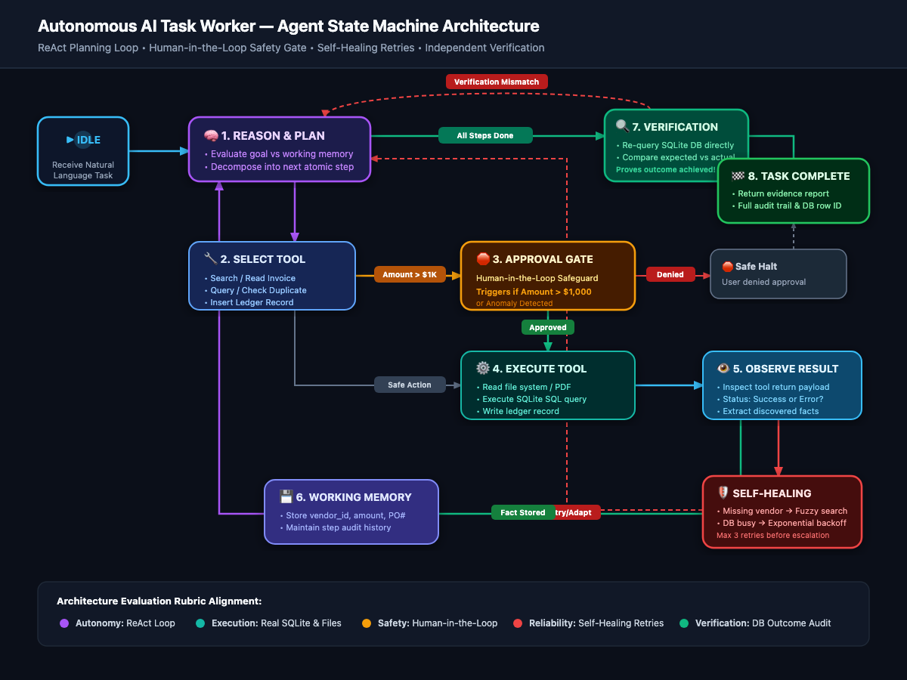

# 🤖 Autonomous AI Task Worker — Finance & Operations Clerk

[]()
[]()
[]()
[]()

> A local autonomous finance workflow prototype. It uses an LLM or deterministic fallback to work with sample invoice files and a seeded SQLite company database, with approval gates and audit evidence for its demo workflows. It does not connect to accounting services or move money.

---

## 📌 Problem Statement & Solution

**The Enterprise Problem:**  
Accounts payable and finance teams spend countless hours manually reading incoming invoices, checking supplier records, cross-referencing purchase orders, logging entries into accounting software, and auditing duplicate submissions.

**The Solution:**  
This project implements an **Autonomous AI Task Worker** capable of taking end-goal natural language directives such as:
> *"Find the latest invoice from Acme Corp, extract the amount and due date, enter it into our internal system, and tell me once it is done."*

The agent selects tools to carry out the workflow, checks resulting ledger records, and produces an audit report. Sample invoices and a local SQLite database make the workflows reproducible.

---

## 📐 Architecture & State Machine

The agent operates on an augmented **ReAct (Reason + Act + Observe)** execution loop with dedicated **Safety**, **Self-Healing**, and **Outcome Verification** checkpoints:



```
[User Task] ➡️ [1. Reason & Plan] ➡️ [2. Select Tool]
                       ⬆️                      ⬇️
            [6. Working Memory]     [3. Approval Gate?] (> $1,000 threshold)
                       ⬆️                /            \
            [5. Observe Result]    (Approved)      (Denied) ➡️ [Safe Halt]
                       ⬆️             ⬇️
             [Self-Healing] ⬅️ [4. Execute Tool (Files/DB)]
                       |
               [All Steps Done]
                       ⬇️
            [7. Independent Verification (DB Audit)]
                       ⬇️
            [8. Task Complete & Evidence Report]
```

---

## 🌟 Rubric & Key Capabilities

| Evaluation Criterion | Implementation in System |
|:---|:---|
| **Tool-driven workflow** | Uses LiteLLM function calling to search and read sample invoices, query company data, check duplicates, and create ledger entries. |
| **Resilience & provenance** | Retries provider rate limits using the suggested delay, can recover from a failed vendor lookup in deterministic mode, and reports whether each run used the LLM or fallback. |
| **Offline fallback** | Runs a deterministic heuristic path when LiteLLM or a matching provider key is unavailable; the fallback supports common demo workflows. |
| **Input safeguards** | Restricts invoice reads to JSON files under the configured invoice directory, rejects malformed invoices, and stops duplicates before ledger writes. |
| **Approval gate** | Requests approval for invoices above the configured threshold before creating a ledger entry. |
| **Outcome checks** | Independently checks inserted ledger records and treats successful read-only invoice searches and database queries as verifiable tasks. Safe halts remain incomplete outcomes. |
| **Audit trail** | Keeps tool-step results and produces a Markdown execution report. |

---

## 📁 Repository Structure

```
autonomous-finance-clerk/
├── agent/
│   ├── core.py              # Central ReAct agent loop (LiteLLM + deterministic engine)
│   ├── memory.py            # Working memory tracking discovered facts & step history
│   ├── planner.py           # Planning & prompt decomposition
│   ├── verifier.py          # Independent outcome audit verifier
│   └── prompts.py           # System prompts enforcing safety and verification
├── tools/
│   ├── registry.py          # Central registry with JSON function schemas
│   ├── invoice_search.py    # Discovers invoices matching vendor/keywords
│   ├── invoice_reader.py    # Parses JSON/PDF invoices and validates schemas
│   ├── database.py          # Safe read-only SQL queries on company database
│   ├── duplicate_checker.py # Prevents double-processing against ledger
│   ├── ledger.py            # Writes transactions into ledger with threshold guard
│   ├── approval.py          # Human-in-the-loop approval module
│   ├── verification.py      # Audits database state persistence
│   └── report.py            # Formats Markdown audit reports
├── company_system/
│   ├── schema.sql           # SQLite schema (vendors, purchase_orders, ledger)
│   ├── seed_data.py         # Realistic seed data
│   ├── setup_db.py          # DB initialization and test reset utility
│   └── company.db           # SQLite database file
├── invoices/                # Sample test invoices
│   ├── acme_corp_INV-2024-0042.json  # Valid high-value ($4,250 - requires approval)
│   ├── globex_INV-2024-0078.json     # Valid low-value ($802.50 - auto-approves)
│   ├── initech_INV-2024-0091.json    # Valid software license renewal
│   ├── duplicate_invoice.json        # Duplicate invoice test case
│   ├── malformed_invoice.json        # Malformed missing amounts test case
│   └── fuzzy_vendor_invoice.json     # Fuzzy vendor variation test case
├── tests/
│   ├── conftest.py          # Automated DB reset before every test
│   └── test_all_scenarios.py# 8 comprehensive automated test suites
├── app.py                   # Streamlit web dashboard
├── main.py                  # Rich CLI application
├── config.py                # Environment configuration
├── requirements.txt         # Project dependencies
└── README.md                # System documentation
```

---

## 🚀 Quick Start (2 Minutes)

### 1. Clone & Install
```bash
git clone https://github.com/binitrajput/autonomous-finance-clerk.git
cd autonomous-finance-clerk

# Create virtual environment
python3 -m venv venv
source venv/bin/activate

# Install dependencies
pip install -r requirements.txt
```

### 2. Configure Environment (Optional)
```bash
cp .env.example .env
# Set MODEL_NAME and the matching provider key in .env.
# Example for Groq-hosted GPT-OSS:
# MODEL_NAME=openai/gpt-oss-120b
# GROQ_API_KEY=your_groq_api_key
# Without a supported key, the agent uses its deterministic fallback.
```

The selected model and key must belong to the same provider. Supported key variables are `GROQ_API_KEY`, `GEMINI_API_KEY` (or `GOOGLE_API_KEY`), `OPENAI_API_KEY`, and `ANTHROPIC_API_KEY`. Never commit `.env` or paste a key into an issue or terminal transcript.

---

## 💻 Running the Applications

### Option A: Interactive CLI
```bash
python main.py
```
Or pass a prompt directly:
```bash
python main.py --task "Process the latest invoice from Acme Corp and enter it into our system."
```
List the available sample invoices:
```bash
python main.py --task "List the available invoices"
```

### Option B: Streamlit Web Dashboard
```bash
streamlit run app.py
```
Features:
- Real-time step-by-step agent thought process
- High-value approval control for the next task (off by default; enabling it preapproves high-value requests in that task)
- Live ERP Database explorer (`ledger`, `vendors`, `purchase_orders`)
- 1-Click test scenario launcher

---

## 🧪 Automated Test Suite (13/13 Passing)

Run the test suite:
```bash
pytest tests/ -v
```

### Test Coverage Breakdown:
1. `test_1_happy_path_with_approval`: Processes the $4,250 sample invoice after an approval callback and verifies the ledger record.
2. `test_2_auto_approval_under_threshold`: Processes the $802.50 sample invoice without requesting approval.
3. `test_3_duplicate_detection_blocked`: Stops on a duplicate and confirms the ledger is unchanged.
4. `test_4_malformed_invoice_handled_safely`: Stops on a malformed invoice and confirms the ledger is unchanged.
5. `test_5_user_denies_approval`: Stops when approval is denied and confirms no ledger record is written.
6. `test_6_fuzzy_vendor_matching`: Matches *"Acme Corporation"* to the seeded *"Acme Corp"* vendor.
7. `test_7_outcome_verification_catches_discrepancy`: Confirms the verifier rejects a missing ledger record.
8. `test_8_generalization_analytical_query`: Answers a read-only ledger query.
9. `test_9_invoice_listing_is_a_verified_read_only_task`: Lists sample invoices and verifies the search result without requiring a ledger write.
10. `test_10_processing_task_is_not_verified_by_invoice_search_alone`: Prevents a successful file search from falsely verifying an incomplete ledger workflow.
11. `test_11_rate_limit_retry_honors_provider_wait_time`: Retries a simulated provider rate limit after the suggested delay.
12. `test_12_run_reports_when_llm_made_the_decisions`: Confirms run evidence distinguishes actual LLM decisions from fallback decisions.
13. `test_13_invoice_reader_blocks_paths_outside_invoice_directory`: Confirms the invoice reader rejects traversal outside the invoice directory.

Tests force deterministic mode and reset the local SQLite database to its seed state before each scenario. They do not exercise live provider/API behavior.

---

## 🌐 Live Cloud Deployment

Deploy in 1-click on [Streamlit Community Cloud](https://share.streamlit.io):
1. Connect your GitHub repository: `binitrajput/autonomous-finance-clerk`
2. Set Main file path: `app.py`
3. Add the model and matching provider key in **App settings → Secrets**, for example:
   ```toml
   MODEL_NAME = "openai/gpt-oss-120b"
   GROQ_API_KEY = "your_groq_api_key_here"
   ```
4. Click **Deploy**. The application uses seeded demo data in a local SQLite database; it is a prototype and does not provide durable production storage or connect to payment systems.
